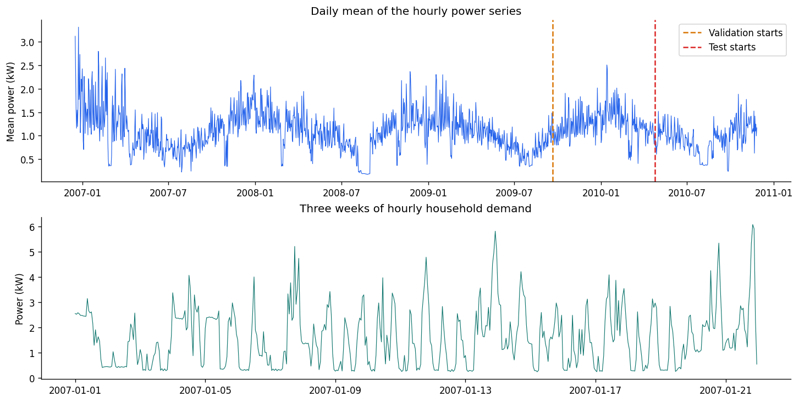
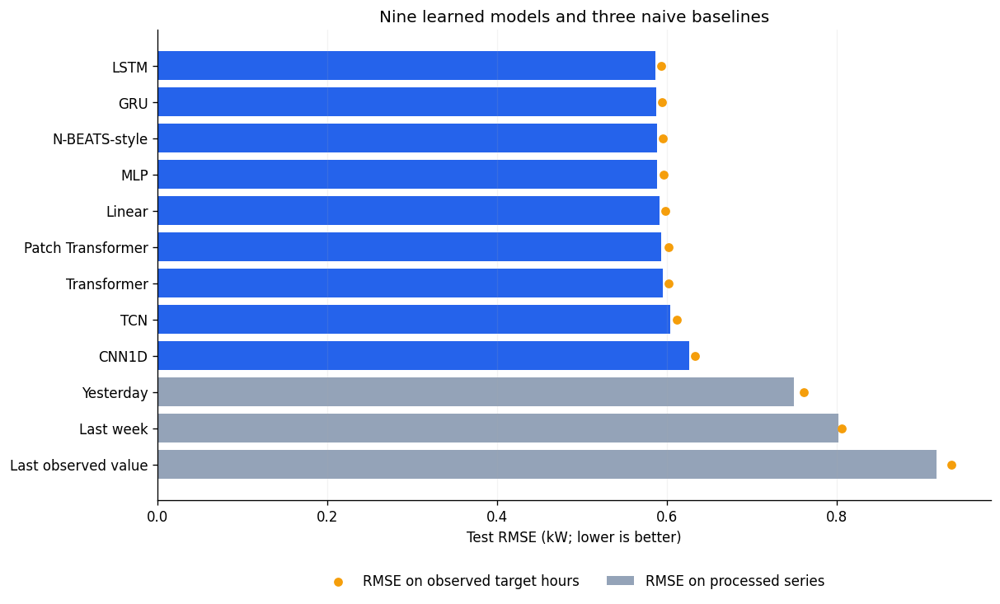

# Comparing Nine Sequence Models for Electricity Forecasting

*Sequence Models for Prediction — Part 15*

Hourly household power consumption has daily patterns, irregular spikes, and missing
measurements. We compare nine models on the same task: predict the next 24 hours
from the previous 168 hourly observations.

The input contains only past demand. Calendar variables, weather, and other electrical
measurements are excluded. This keeps the input information consistent across models.
The comparison measures forecast error and model size.

## Data source and preprocessing

The data comes from the [UCI Individual Household Electric Power Consumption dataset](https://archive.ics.uci.edu/dataset/235/individual+household+electric+power+consumption).
It contains 2,075,259 minute-level measurements from one home in Sceaux, France,
recorded between December 2006 and November 2010. The [original ZIP](https://archive.ics.uci.edu/static/public/235/individual+household+electric+power+consumption.zip)
contains `household_power_consumption.txt`.

We select `Global_active_power` and average the available minute readings within
each clock hour. The result has 34,589 hourly observations. The target is mean
active power in kilowatts, not the sum of the minute-level values.

There are 421 hours with no valid readings. Those hours are forward-filled from
the preceding observed hour. No future observation is used to fill a gap. The
first and last clock hours are partial and are retained. Timestamps keep their
original local-clock labels without a timezone conversion.



*The upper panel shows the chronological split. The lower panel shows the variation
within a three-week period.*

## Forecasting task and evaluation

At forecast origin `t`, each model uses the preceding week and predicts the next day:

```python
X = demand[t - 168:t]  # observed history
y = demand[t:t + 24]   # 24 future hourly values
```

Every implementation receives a tensor with shape `[batch, 168, 1]` and returns
`[batch, 24]`. The entire future path is predicted directly rather than recursively
feeding predictions back into the model.

The series is split chronologically into 70% training, 15% validation, and 15% test
periods. Every target window stays within one partition. Validation and test inputs
can use earlier observed history from the preceding partition. Standardization
statistics are fitted on the training period only.

This gives 24,021 training origins, 5,165 validation origins, and 5,166 test origins.
Origins are one hour apart, so their 24-hour targets overlap and forecast errors
are correlated.

The primary metric is RMSE in kW, calculated over all test origins and horizons
after reversing standardization. It includes forward-filled target hours. A second
score excludes target hours that had no valid minute readings.

## Model configurations

The linear model maps the flattened input window directly to 24 outputs. The MLP
uses two hidden layers with 256 and 128 units. The GRU and LSTM each use one
64-unit recurrent layer and a final prediction head.

CNN1D uses three convolutional layers followed by global average pooling. The TCN
uses four causal convolutions with kernel size 3 and dilations 1, 2, 4, and 8.
Its final state therefore has a 31-hour receptive field, which is shorter than
the 168-hour input.

The Transformer uses 64-dimensional tokens, learned positions, two encoder blocks,
four attention heads, and feed-forward width 128. The patch version groups the
week into fourteen nonoverlapping 12-hour patches before applying the encoder.

The N-BEATS-style model has three residual dense blocks, each with three 256-unit
hidden layers and separate backcast and forecast heads. It is a generic residual
implementation rather than a full reproduction of the original research model.

All models use AdamW with learning rate 0.001, weight decay 0.0001, batch size 256,
and MSE on standardized targets. Training stops after at most 15 epochs or three
epochs without validation improvement. The checkpoint with the lowest validation
loss is restored before test evaluation. This run uses one seed, 42.

Three additional baselines copy yesterday's profile, last week's profile, or the
last observed value across the forecast horizon.

## Results

| Model | Test RMSE (kW) | Parameters |
|---|---:|---:|
| LSTM | 0.5864 | 18,712 |
| GRU | 0.5876 | 14,424 |
| N-BEATS-style | 0.5882 | 672,576 |
| MLP | 0.5886 | 79,256 |
| Linear | 0.5916 | 4,056 |
| Patch Transformer | 0.5935 | 70,360 |
| Transformer | 0.5957 | 79,512 |
| TCN | 0.6039 | 38,872 |
| CNN1D | 0.6267 | 32,600 |
| Yesterday | 0.7496 | — |
| Last week | 0.8025 | — |
| Last observed value | 0.9179 | — |

*Lower RMSE is better. Parameter counts refer to trainable model parameters.*

LSTM has the lowest test RMSE at **0.5864 kW**. GRU, N-BEATS-style,
and MLP are close, at 0.5876,
0.5882, and 0.5886 kW.
The small differences do not establish a stable ordering from a single run.

All nine learned models beat the three naive baselines. Copying yesterday gives
an RMSE of 0.7496 kW, so LSTM reduces that
error by 21.78%.



*Bars include forward-filled targets. Orange markers exclude target hours with
no observed minute readings. Both metrics use the same model predictions.*

LSTM's observed-target-only RMSE is 0.5935 kW. The increase
from the primary score shows that imputed hours affect the reported accuracy.

## Accuracy and model size

The linear model reaches 0.5916 kW with 4,056 parameters. Its
RMSE is 0.89% higher than LSTM's. It remains competitive with models
that use recurrence, attention, or multiple nonlinear layers.

The two recurrent models are also relatively compact: LSTM has 18,712 parameters
and GRU has 14,424. The N-BEATS-style network uses 672,576 parameters for a similar
test error. Parameter count does not measure every deployment cost, but the
difference is relevant when memory or model size matters.

The attention models do not improve on the recurrent models in these configurations.
That result is specific to this dataset, input length, and training budget. It does
not establish how the architectures would compare with more data or additional variables.

## Limits of this comparison

The TCN receives the same 168-hour tensor but its prediction can depend on only
the most recent 31 hours. The CNN's global pooling removes exact positions, and
its validation error is still decreasing at epoch 15. Their results combine
architectural choices with limits imposed by these configurations.

This is one household, one split, one seed, and a fixed training schedule. Model
capacity is not matched, and no architecture-specific hyperparameter search is
performed. Boosted-tree models are not included.
Multiple seeds, rolling evaluation periods, a wider TCN receptive field, and a
boosted-tree baseline would provide a more complete comparison.

The full [Jupyter notebook](electricity_models_demand_only.ipynb) includes the data snapshot,
all model definitions, executed outputs, learning curves, and per-horizon errors.
The accompanying files include the processed CSV, source checksums, predictions,
and saved checkpoints.

## Data reference

Hebrail, G. & Berard, A. (2006). *Individual Household Electric Power Consumption*
[Dataset]. UCI Machine Learning Repository. https://doi.org/10.24432/C58K54.
Licensed under [CC BY 4.0](https://creativecommons.org/licenses/by/4.0/).
The data was changed by selecting global active power, averaging by hour,
forward-filling empty hours, and constructing forecasting windows.
