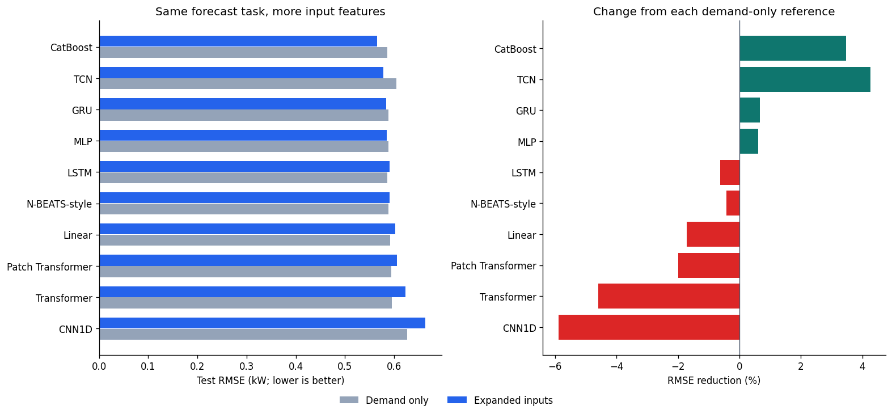

# Electricity forecasting: models and input features

Predict the next 24 hourly demand values from the previous 168 hours. This project
includes the executed demand-only experiment and an expanded-input comparison
using all seven electrical measurements, calendar encodings, and recent-demand
summaries. The expanded comparison contains nine neural models and CatBoost.

Start with [electricity_models.ipynb](electricity_models.ipynb). Its outputs are
saved, and the processed CSV is embedded. The complete readable code is also in
[electricity_models_multifeature.md](electricity_models_multifeature.md).

## Run on Mac or Linux

Open a terminal in this project folder:

```bash
python3 -m venv .venv
source .venv/bin/activate
python -m pip install --upgrade pip
python -m pip install -r requirements.txt
python -m jupyter lab electricity_models.ipynb
```

On Windows, activate the environment with `.venv\Scripts\activate` instead.
Use a Python version supported by your PyTorch build; the saved run used Python
3.12.14. [requirements-multifeature-tested.txt](requirements-multifeature-tested.txt)
records the executed library versions. A fresh full run trains all nine neural
models and two CatBoost configurations; reading saved outputs needs no training.

`REQUESTED_DEVICE = "auto"` selects an available PyTorch backend. Set `"cpu"`
for the portable reference. For GPU/TPU use the appropriate PyTorch packages and
see [HARDWARE_SETUP.md](HARDWARE_SETUP.md). The saved full comparison was run on
CPU. CatBoost uses CPU on every platform in this notebook. Accelerator operators
are checked with a preflight; physical Mac/GPU/TPU hardware was not tested here.

## Results

CatBoost has the lowest expanded-input test RMSE: **0.5656 kW**, compared with
**0.5859 kW** for its demand-only baseline, a **3.47% reduction**. Expanded inputs
improved **4 of 10** matched configurations. These results use one seed and a
fixed configuration per model; more features did not consistently reduce error.

See [the paired results](RESULTS_multifeature.md) and the full
[comparison CSV](outputs_multifeature/feature_comparison.csv).



## Included files

| Path | Contents |
|---|---|
| [electricity_models.ipynb](electricity_models.ipynb) | Current executed notebook; expanded features and CatBoost |
| [electricity_models_multifeature.md](electricity_models_multifeature.md) | Runnable Markdown export with measured results and figures |
| [data/electricity_hourly_multifeature.csv](data/electricity_hourly_multifeature.csv) | Expanded hourly dataset for the current notebook |
| [outputs_multifeature/](outputs_multifeature/) | Scores, predictions, scalers, plots, histories, and fitted model files |
| [electricity_models_demand_only.ipynb](electricity_models_demand_only.ipynb) | Original demand-only executed notebook |
| [data/electricity_hourly.csv](data/electricity_hourly.csv) | Original demand-only CSV |
| [outputs/](outputs/) | Original demand-only results and fitted models |
| [Medium_article.md](Medium_article.md), [Medium_article_runnable.md](Medium_article_runnable.md) | Original demand-only articles |
| [DATA_SOURCE.md](DATA_SOURCE.md) | Dataset provenance, transformations, checksums, and attribution |
| [GITHUB_SETUP.md](GITHUB_SETUP.md) | Upload instructions and Raw CSV URL examples |
| [MANIFEST.sha256](MANIFEST.sha256) | File checksums for this release |

The original articles describe demand-only inputs and exclude CatBoost. Use the
current notebook or its Markdown export for the expanded-input study.

## Data and configuration

The CSVs are included, so no GitHub URL is required to run locally. To load a
hosted CSV, set `DATA_URL` to its public Raw URL; examples are in
[GITHUB_SETUP.md](GITHUB_SETUP.md). The expanded notebook needs the expanded CSV.
Set `SOURCE_MODE = "uci"` to rebuild it from the pinned official UCI archive.

Each forecast uses completed historical measurement hours. Future calendar values
are known at forecast time; future measured electrical values are excluded.
All scalers use training data. Targets stay inside chronological partitions.
The reported RMSE pools every test origin and horizon in kW; an additional score
excludes fully imputed target hours. Origins overlap, so errors are correlated.

Set `RUN_UNIVARIATE_NEURAL = True` to rerun the original nine neural references.
`REPORT_TIMING = False` is the default. Enable it to record local fit times and
machine details; the main comparison excludes timing. Saved model files and
prediction arrays are included, so the published scores can be inspected without
retraining. The raw minute archive is downloaded from UCI only when rebuilding.

Source: Hebrail, G. & Berard, A. (2006), *Individual Household Electric Power
Consumption*, UCI, [DOI 10.24432/C58K54](https://doi.org/10.24432/C58K54), CC BY 4.0.
